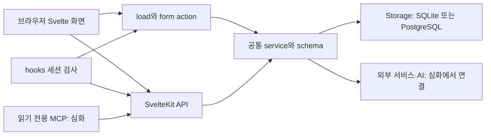

# studyMidpoint — 중간 응용: 로그인 게시판

## ① 목표 한 줄

study0~10만으로 로그인·게시판 CRUD·첫 배포 점검을 완성한다.

## ② 📖 이론

이 응용은 라우팅·상태·폼·DB·인증·테스트을 하나의 **소나무 게시판**으로 연결한다. 화면과 API는 같은 service를 사용하며 권한·검증 규칙을 복사하지 않는다. 레고 부품처럼 각 단계의 계약이 맞아야 조립 후에도 안전하게 동작한다. SvelteKit 외 프레임워크를 함께 사용하거나 비교하지 않는다.

### 목표·기능 목록

- 회원가입·로그인·로그아웃·세션 만료·작성자 권한
- 게시글 목록·상세·검색·페이지네이션·등록·부분 수정·삭제
- 댓글 목록·등록·본인 댓글 삭제, 내 글만 보기·페이지 크기 선택
- SSR·form action·JSON API·requestId 오류 추적

### 폴더 구조

```text
project/
├─ src/routes/board/[id]/      목록·상세 UI와 서버 load/action
├─ src/routes/api/[...path]/   공통 API v1
├─ src/lib/course/            공개 schema·상태
├─ src/lib/server/course/     DB·세션·검증·외부 연동
├─ src/hooks.server.ts        요청별 사용자·로그·CORS
├─ tests/                     단위·HTTP 계약 검사
├─ scripts/                   MCP·측정·worker
├─ static/openapi.json        API 계약
└─ Dockerfile·server.mjs       운영 실행
```

### DB·API 연동 구성도



## ③ 🛠️ 실기 — 단계별 구현 순서·전체 코드

1. study0의 환경 설정과 study1~3의 `/lab`로 Svelte 문법·props·상태를 익힌다.
2. `/board` 목록→`/board/[id]` 상세를 만들고 load 결과가 SSR HTML에 포함되는지 확인한다.
3. SQLite members·posts·comments·sessions 테이블을 생성한다.
4. 회원가입·로그인·HttpOnly 쿠키·hooks의 locals.member를 연결한다.
5. action으로 글쓰기, 같은 service를 이용하는 API CRUD, 상세 화면 수정·삭제를 연결한다.
6. 두 계정으로 401·403, 빈 값 400, 생성 201·Location, 삭제 204를 확인한다.
7. 단위·요청 검사 후 adapter-node 빌드로 첫 실행을 확인한다. 심화 UI·외부 서비스·AI는 아직 필요하지 않다.

구현을 처음부터 따라가려면 위 순서의 study 문서에서 파일을 만든다. 아래는 응용의 진입 파일 전체다. DB·인증 전체 코드는 [study6](study6.md)·[study7](study7.md), API 전체 코드는 [study6](study6.md), 심화 파일은 각 번호 문서에 줄별 설명과 함께 있다. JS와 TS의 경로·기능은 같다.

### `src/routes/board/+page.server.ts` 전체 코드

[실제 파일](ts_version/project/src/routes/board/+page.server.ts) · 줄 번호는 아래 코드 첫 줄부터 센다. 빈 줄과 닫는 괄호도 포함한다.

```ts
import { fail } from '@sveltejs/kit';
import type { PageServerLoad, Actions } from './$types';
import { list, write } from '#lib/server/course/service.js';
import { ApiError } from '#lib/server/course/errors.js';
export const load: PageServerLoad = async ({ url, locals }) => ({
	...(await list(url.searchParams, locals.member)),
	member: locals.member,
	mine: url.searchParams.get('mine') === 'true'
});
export const actions: Actions = {
	default: async ({ request, locals }) => {
		const form = await request.formData();
		try {
			await write(
				{ title: String(form.get('title') ?? ''), body: String(form.get('body') ?? ''), tags: [] },
				locals.member
			);
			return { success: true };
		} catch (error) {
			if (error instanceof ApiError)
				return fail(error.status, { message: error.message, fields: error.fields });
			throw error;
		}
	}
};
```

**줄별 설명**

| 줄 | 설명 |
|---|---|
| 1 | `@sveltejs/kit`에서 필요한 함수·컴포넌트를 가져온다. |
| 2 | `./$types`에서 필요한 타입만 가져와 실행 번들에 넣지 않는다. |
| 3 | `#lib/server/course/service.js`에서 필요한 함수·컴포넌트를 가져온다. |
| 4 | `#lib/server/course/errors.js`에서 필요한 함수·컴포넌트를 가져온다. |
| 5 | 이 선언을 외부에 공개한다. 라우트 파일은 SvelteKit이 이름을 기준으로 호출한다. |
| 6 | 비동기 작업이 끝날 때까지 기다린다. 다음 단계가 결과를 받기 전에 진행하지 않는다. |
| 7 | 객체·설정·모델의 필드를 지정한다. 이름은 호출자와의 계약이다. |
| 8 | 객체·설정·모델의 필드를 지정한다. 이름은 호출자와의 계약이다. |
| 9 | 앞에서 연 블록·함수·자료 선언을 닫는다. |
| 10 | 이 선언을 외부에 공개한다. 라우트 파일은 SvelteKit이 이름을 기준으로 호출한다. |
| 11 | 객체·설정·모델의 필드를 지정한다. 이름은 호출자와의 계약이다. |
| 12 | 비동기 작업이 끝날 때까지 기다린다. 다음 단계가 결과를 받기 전에 진행하지 않는다. |
| 13 | 현재 블록의 계산·호출을 수행한다. 위에서 선언한 입력을 아래 결과로 이어 준다. |
| 14 | 비동기 작업이 끝날 때까지 기다린다. 다음 단계가 결과를 받기 전에 진행하지 않는다. |
| 15 | 객체·설정·모델의 필드를 지정한다. 이름은 호출자와의 계약이다. |
| 16 | 현재 블록의 계산·호출을 수행한다. 위에서 선언한 입력을 아래 결과로 이어 준다. |
| 17 | 앞에서 연 블록·함수·자료 선언을 닫는다. |
| 18 | 계산 결과 또는 응답을 호출자에게 돌려주고 현재 함수를 마친다. |
| 19 | 실패를 처리한다. 내부 예외·비밀을 응답에 그대로 노출하지 않는다. |
| 20 | 입력·권한·성공 여부에 따라 실행 경로를 나눈다. |
| 21 | 계산 결과 또는 응답을 호출자에게 돌려주고 현재 함수를 마친다. |
| 22 | 잘못된 흐름을 예외로 중단한다. 가장 가까운 오류 처리 경계가 응답으로 바꾼다. |
| 23 | 앞에서 연 블록·함수·자료 선언을 닫는다. |
| 24 | 앞에서 연 블록·함수·자료 선언을 닫는다. |
| 25 | 앞에서 연 블록·함수·자료 선언을 닫는다. |

### `src/routes/board/+page.svelte` 전체 코드

[실제 파일](ts_version/project/src/routes/board/+page.svelte) · 줄 번호는 아래 코드 첫 줄부터 센다. 빈 줄과 닫는 괄호도 포함한다.

```svelte
<script lang="ts">
	import { resolve } from '$app/paths';
	import { enhance } from '$app/forms';
	import CourseAuth from '#lib/components/CourseAuth.svelte';
	import type { PageProps } from './$types';
	let { data, form }: PageProps = $props();
	let submitting = $state(false);
</script>

<svelte:head
	><title>소나무 게시판</title><meta
		name="description"
		content="SvelteKit 단일 게시판 학습 서비스"
	/></svelte:head
>
<h1>소나무 게시판</h1>
<nav>
	<a href={resolve('/lab')}>기초 실습</a> · <a href={resolve('/ui')}>UI 실습</a> ·
	<a href={resolve('/integrations')}>외부 서비스</a>
	· <a href={resolve('/ai')}>문서 AI</a> · <a href={resolve('/api-docs')}>API 문서</a>
</nav>
<CourseAuth />
<p>{data.member ? `${data.member.nickname}님` : '읽기는 누구나, 쓰기는 로그인 후 가능합니다.'}</p>
<form method="GET">
	<label>검색 <input name="q" value={data.meta.q} /></label>
	<label
		>페이지 크기 <select name="limit" value={String(data.meta.limit)}
			><option>5</option><option>10</option><option>50</option></select
		></label
	>
	<label><input type="checkbox" name="mine" value="true" checked={data.mine} /> 내 글만</label
	><button>검색</button>
</form>
<ul>
	{#each data.data as post (post.id)}<li>
			<a href={resolve('/board/[id]', { id: String(post.id) })}>{post.title}</a> · {post.author
				.nickname} · 댓글 {post.commentCount}
		</li>{:else}<li>게시글이 없습니다.</li>{/each}
</ul>
<p>{data.meta.page} / {data.meta.totalPages} 페이지 · 총 {data.meta.total}개</p>
<a
	href={resolve(
		`/board?q=${encodeURIComponent(data.meta.q)}&limit=${data.meta.limit}&mine=${data.mine}&page=${Math.max(1, data.meta.page - 1)}`
	)}>이전</a
>
<a
	href={resolve(
		`/board?q=${encodeURIComponent(data.meta.q)}&limit=${data.meta.limit}&mine=${data.mine}&page=${data.meta.page + 1}`
	)}>다음</a
>
{#if data.member}
	<form
		method="POST"
		use:enhance={() => {
			submitting = true;
			return async ({ update }) => {
				try {
					await update();
				} finally {
					submitting = false;
				}
			};
		}}
	>
		<label>제목 <input name="title" required maxlength="200" /></label>
		{#if form && 'fields' in form && form.fields?.title}<p role="alert">
				{form.fields.title.join(', ')}
			</p>{/if}
		<label>본문 <textarea name="body" required maxlength="20000"></textarea></label>
		{#if form && 'fields' in form && form.fields?.body}<p role="alert">
				{form.fields.body.join(', ')}
			</p>{/if}
		<button disabled={submitting}>{submitting ? '저장 중' : '글 등록'}</button>
	</form>
{/if}
{#if form && 'message' in form}<p role="alert">{form.message}</p>{/if}
{#if form && 'success' in form}<p role="status">저장했습니다.</p>{/if}
```

**줄별 설명**

| 줄 | 설명 |
|---|---|
| 1 | 컴포넌트 스크립트 구간의 경계를 정한다. |
| 2 | `$app/paths`에서 필요한 함수·컴포넌트를 가져온다. |
| 3 | `$app/forms`에서 필요한 함수·컴포넌트를 가져온다. |
| 4 | `#lib/components/CourseAuth.svelte`에서 필요한 함수·컴포넌트를 가져온다. |
| 5 | `./$types`에서 필요한 타입만 가져와 실행 번들에 넣지 않는다. |
| 6 | 부모 또는 라우터에서 받은 props를 읽는다. 상태의 전달 경계다. |
| 7 | 사용자가 바꿀 원본을 반응형 상태로 선언한다. 값 변경이 연결된 화면을 갱신한다. |
| 8 | 컴포넌트 스크립트 구간의 경계를 정한다. |
| 9 | 가독성을 위해 구간을 나누는 빈 줄이다. |
| 10 | 화면의 의미 있는 HTML 요소·폼·안내 문구를 렌더한다. 값 보간은 기본 이스케이프된다. |
| 11 | 현재 블록의 계산·호출을 수행한다. 위에서 선언한 입력을 아래 결과로 이어 준다. |
| 12 | 현재 블록의 계산·호출을 수행한다. 위에서 선언한 입력을 아래 결과로 이어 준다. |
| 13 | 현재 블록의 계산·호출을 수행한다. 위에서 선언한 입력을 아래 결과로 이어 준다. |
| 14 | 객체·설정·모델의 필드를 지정한다. 이름은 호출자와의 계약이다. |
| 15 | 현재 블록의 계산·호출을 수행한다. 위에서 선언한 입력을 아래 결과로 이어 준다. |
| 16 | 화면의 의미 있는 HTML 요소·폼·안내 문구를 렌더한다. 값 보간은 기본 이스케이프된다. |
| 17 | 화면의 의미 있는 HTML 요소·폼·안내 문구를 렌더한다. 값 보간은 기본 이스케이프된다. |
| 18 | 화면의 의미 있는 HTML 요소·폼·안내 문구를 렌더한다. 값 보간은 기본 이스케이프된다. |
| 19 | 화면의 의미 있는 HTML 요소·폼·안내 문구를 렌더한다. 값 보간은 기본 이스케이프된다. |
| 20 | 현재 블록의 계산·호출을 수행한다. 위에서 선언한 입력을 아래 결과로 이어 준다. |
| 21 | 화면의 의미 있는 HTML 요소·폼·안내 문구를 렌더한다. 값 보간은 기본 이스케이프된다. |
| 22 | 화면의 의미 있는 HTML 요소·폼·안내 문구를 렌더한다. 값 보간은 기본 이스케이프된다. |
| 23 | 화면의 의미 있는 HTML 요소·폼·안내 문구를 렌더한다. 값 보간은 기본 이스케이프된다. |
| 24 | 화면의 의미 있는 HTML 요소·폼·안내 문구를 렌더한다. 값 보간은 기본 이스케이프된다. |
| 25 | 화면의 의미 있는 HTML 요소·폼·안내 문구를 렌더한다. 값 보간은 기본 이스케이프된다. |
| 26 | 화면의 의미 있는 HTML 요소·폼·안내 문구를 렌더한다. 값 보간은 기본 이스케이프된다. |
| 27 | 현재 블록의 계산·호출을 수행한다. 위에서 선언한 입력을 아래 결과로 이어 준다. |
| 28 | 현재 블록의 계산·호출을 수행한다. 위에서 선언한 입력을 아래 결과로 이어 준다. |
| 29 | 현재 블록의 계산·호출을 수행한다. 위에서 선언한 입력을 아래 결과로 이어 준다. |
| 30 | 현재 블록의 계산·호출을 수행한다. 위에서 선언한 입력을 아래 결과로 이어 준다. |
| 31 | 화면의 의미 있는 HTML 요소·폼·안내 문구를 렌더한다. 값 보간은 기본 이스케이프된다. |
| 32 | 현재 블록의 계산·호출을 수행한다. 위에서 선언한 입력을 아래 결과로 이어 준다. |
| 33 | 화면의 의미 있는 HTML 요소·폼·안내 문구를 렌더한다. 값 보간은 기본 이스케이프된다. |
| 34 | 화면의 의미 있는 HTML 요소·폼·안내 문구를 렌더한다. 값 보간은 기본 이스케이프된다. |
| 35 | id/key를 기준으로 목록 항목의 DOM과 상태를 연결한다. |
| 36 | 화면의 의미 있는 HTML 요소·폼·안내 문구를 렌더한다. 값 보간은 기본 이스케이프된다. |
| 37 | 현재 블록의 계산·호출을 수행한다. 위에서 선언한 입력을 아래 결과로 이어 준다. |
| 38 | 조건에 맞는 UI만 렌더하거나 빈 상태를 표시한다. |
| 39 | 화면의 의미 있는 HTML 요소·폼·안내 문구를 렌더한다. 값 보간은 기본 이스케이프된다. |
| 40 | 화면의 의미 있는 HTML 요소·폼·안내 문구를 렌더한다. 값 보간은 기본 이스케이프된다. |
| 41 | 화면의 의미 있는 HTML 요소·폼·안내 문구를 렌더한다. 값 보간은 기본 이스케이프된다. |
| 42 | 현재 블록의 계산·호출을 수행한다. 위에서 선언한 입력을 아래 결과로 이어 준다. |
| 43 | 현재 블록의 계산·호출을 수행한다. 위에서 선언한 입력을 아래 결과로 이어 준다. |
| 44 | 현재 블록의 계산·호출을 수행한다. 위에서 선언한 입력을 아래 결과로 이어 준다. |
| 45 | 현재 블록의 계산·호출을 수행한다. 위에서 선언한 입력을 아래 결과로 이어 준다. |
| 46 | 화면의 의미 있는 HTML 요소·폼·안내 문구를 렌더한다. 값 보간은 기본 이스케이프된다. |
| 47 | 현재 블록의 계산·호출을 수행한다. 위에서 선언한 입력을 아래 결과로 이어 준다. |
| 48 | 현재 블록의 계산·호출을 수행한다. 위에서 선언한 입력을 아래 결과로 이어 준다. |
| 49 | 현재 블록의 계산·호출을 수행한다. 위에서 선언한 입력을 아래 결과로 이어 준다. |
| 50 | 현재 블록의 계산·호출을 수행한다. 위에서 선언한 입력을 아래 결과로 이어 준다. |
| 51 | 조건에 맞는 UI만 렌더하거나 빈 상태를 표시한다. |
| 52 | 화면의 의미 있는 HTML 요소·폼·안내 문구를 렌더한다. 값 보간은 기본 이스케이프된다. |
| 53 | 현재 블록의 계산·호출을 수행한다. 위에서 선언한 입력을 아래 결과로 이어 준다. |
| 54 | 객체·설정·모델의 필드를 지정한다. 이름은 호출자와의 계약이다. |
| 55 | 현재 블록의 계산·호출을 수행한다. 위에서 선언한 입력을 아래 결과로 이어 준다. |
| 56 | 계산 결과 또는 응답을 호출자에게 돌려주고 현재 함수를 마친다. |
| 57 | 현재 블록의 계산·호출을 수행한다. 위에서 선언한 입력을 아래 결과로 이어 준다. |
| 58 | 비동기 작업이 끝날 때까지 기다린다. 다음 단계가 결과를 받기 전에 진행하지 않는다. |
| 59 | 성공·실패와 관계없이 제출 잠금 또는 연결 자원을 정리한다. |
| 60 | 현재 블록의 계산·호출을 수행한다. 위에서 선언한 입력을 아래 결과로 이어 준다. |
| 61 | 앞에서 연 블록·함수·자료 선언을 닫는다. |
| 62 | 앞에서 연 블록·함수·자료 선언을 닫는다. |
| 63 | 현재 블록의 계산·호출을 수행한다. 위에서 선언한 입력을 아래 결과로 이어 준다. |
| 64 | 현재 블록의 계산·호출을 수행한다. 위에서 선언한 입력을 아래 결과로 이어 준다. |
| 65 | 화면의 의미 있는 HTML 요소·폼·안내 문구를 렌더한다. 값 보간은 기본 이스케이프된다. |
| 66 | 조건에 맞는 UI만 렌더하거나 빈 상태를 표시한다. |
| 67 | 현재 블록의 계산·호출을 수행한다. 위에서 선언한 입력을 아래 결과로 이어 준다. |
| 68 | 조건에 맞는 UI만 렌더하거나 빈 상태를 표시한다. |
| 69 | 화면의 의미 있는 HTML 요소·폼·안내 문구를 렌더한다. 값 보간은 기본 이스케이프된다. |
| 70 | 조건에 맞는 UI만 렌더하거나 빈 상태를 표시한다. |
| 71 | 현재 블록의 계산·호출을 수행한다. 위에서 선언한 입력을 아래 결과로 이어 준다. |
| 72 | 조건에 맞는 UI만 렌더하거나 빈 상태를 표시한다. |
| 73 | 화면의 의미 있는 HTML 요소·폼·안내 문구를 렌더한다. 값 보간은 기본 이스케이프된다. |
| 74 | 화면의 의미 있는 HTML 요소·폼·안내 문구를 렌더한다. 값 보간은 기본 이스케이프된다. |
| 75 | 조건에 맞는 UI만 렌더하거나 빈 상태를 표시한다. |
| 76 | 조건에 맞는 UI만 렌더하거나 빈 상태를 표시한다. |
| 77 | 조건에 맞는 UI만 렌더하거나 빈 상태를 표시한다. |

### `src/routes/board/[id]/+page.svelte` 전체 코드

[실제 파일](ts_version/project/src/routes/board/[id]/+page.svelte) · 줄 번호는 아래 코드 첫 줄부터 센다. 빈 줄과 닫는 괄호도 포함한다.

```svelte
<script lang="ts">
	import { resolve } from '$app/paths';
	import { invalidateAll, goto } from '$app/navigation';
	import type { PageProps } from './$types';
	let { data }: PageProps = $props();
	let title = $state(''),
		body = $state(''),
		comment = $state(''),
		message = $state(''),
		busy = $state(false);
	$effect(() => {
		title = data.post.title;
		body = data.post.body;
	});
	async function send(path: string, method: string, payload?: unknown) {
		if (busy) return;
		busy = true;
		message = '';
		try {
			const response = await fetch(path, {
				method,
				headers: { 'content-type': 'application/json' },
				body: payload === undefined ? undefined : JSON.stringify(payload)
			});
			if (!response.ok) throw new Error((await response.json()).error.message);
			if (method === 'DELETE' && path === '/api/posts/' + data.post.id)
				await goto(resolve('/board'));
			else {
				comment = '';
				await invalidateAll();
			}
		} catch (error) {
			message = error instanceof Error ? error.message : '요청 실패';
		} finally {
			busy = false;
		}
	}
</script>

<h1>{data.post.title}</h1>
<p>{data.post.body}</p>
<p>{data.post.author.nickname} · {data.post.createdAt}</p>
{#if data.member?.id === data.post.author.id}
	<form
		onsubmit={(event) => {
			event.preventDefault();
			send('/api/posts/' + data.post.id, 'PATCH', { title, body });
		}}
	>
		<label>제목 <input bind:value={title} required maxlength="200" /></label><label
			>본문 <textarea bind:value={body} required></textarea></label
		>
		<button disabled={busy}>수정</button><button
			disabled={busy}
			type="button"
			onclick={() => send('/api/posts/' + data.post.id, 'DELETE')}>삭제</button
		>
	</form>
{/if}
<h2>댓글</h2>
<ul>
	{#each data.comments as item (item.id)}<li>
			{item.author.nickname}: {item.body}
			{#if data.member?.id === item.author.id}<button
					disabled={busy}
					onclick={() => send('/api/comments/' + item.id, 'DELETE')}>댓글 삭제</button
				>{/if}
		</li>{/each}
</ul>
{#if data.member}<form
		onsubmit={(event) => {
			event.preventDefault();
			send('/api/posts/' + data.post.id + '/comments', 'POST', { body: comment });
		}}
	>
		<label>댓글 <textarea bind:value={comment} required maxlength="2000"></textarea></label><button
			disabled={busy}>댓글 등록</button
		>
	</form>{/if}
<p role="alert">{message}</p>
<a href={resolve('/board')}>목록</a>
```

**줄별 설명**

| 줄 | 설명 |
|---|---|
| 1 | 컴포넌트 스크립트 구간의 경계를 정한다. |
| 2 | `$app/paths`에서 필요한 함수·컴포넌트를 가져온다. |
| 3 | `$app/navigation`에서 필요한 함수·컴포넌트를 가져온다. |
| 4 | `./$types`에서 필요한 타입만 가져와 실행 번들에 넣지 않는다. |
| 5 | 부모 또는 라우터에서 받은 props를 읽는다. 상태의 전달 경계다. |
| 6 | 사용자가 바꿀 원본을 반응형 상태로 선언한다. 값 변경이 연결된 화면을 갱신한다. |
| 7 | 사용자가 바꿀 원본을 반응형 상태로 선언한다. 값 변경이 연결된 화면을 갱신한다. |
| 8 | 사용자가 바꿀 원본을 반응형 상태로 선언한다. 값 변경이 연결된 화면을 갱신한다. |
| 9 | 사용자가 바꿀 원본을 반응형 상태로 선언한다. 값 변경이 연결된 화면을 갱신한다. |
| 10 | 사용자가 바꿀 원본을 반응형 상태로 선언한다. 값 변경이 연결된 화면을 갱신한다. |
| 11 | 의존 값이 바뀔 때 외부 상태와 동기화한다. 일반 계산은 derived에 둔다. |
| 12 | 현재 블록의 계산·호출을 수행한다. 위에서 선언한 입력을 아래 결과로 이어 준다. |
| 13 | 현재 블록의 계산·호출을 수행한다. 위에서 선언한 입력을 아래 결과로 이어 준다. |
| 14 | 앞에서 연 블록·함수·자료 선언을 닫는다. |
| 15 | 객체·설정·모델의 필드를 지정한다. 이름은 호출자와의 계약이다. |
| 16 | 입력·권한·성공 여부에 따라 실행 경로를 나눈다. |
| 17 | 현재 블록의 계산·호출을 수행한다. 위에서 선언한 입력을 아래 결과로 이어 준다. |
| 18 | 현재 블록의 계산·호출을 수행한다. 위에서 선언한 입력을 아래 결과로 이어 준다. |
| 19 | 현재 블록의 계산·호출을 수행한다. 위에서 선언한 입력을 아래 결과로 이어 준다. |
| 20 | 비동기 작업이 끝날 때까지 기다린다. 다음 단계가 결과를 받기 전에 진행하지 않는다. |
| 21 | 현재 블록의 계산·호출을 수행한다. 위에서 선언한 입력을 아래 결과로 이어 준다. |
| 22 | 객체·설정·모델의 필드를 지정한다. 이름은 호출자와의 계약이다. |
| 23 | 자료를 JSON 문자열로 직렬화해 저장·전송 경계에 맞춘다. |
| 24 | 앞에서 연 블록·함수·자료 선언을 닫는다. |
| 25 | 비동기 작업이 끝날 때까지 기다린다. 다음 단계가 결과를 받기 전에 진행하지 않는다. |
| 26 | 입력·권한·성공 여부에 따라 실행 경로를 나눈다. |
| 27 | 비동기 작업이 끝날 때까지 기다린다. 다음 단계가 결과를 받기 전에 진행하지 않는다. |
| 28 | 입력·권한·성공 여부에 따라 실행 경로를 나눈다. |
| 29 | 현재 블록의 계산·호출을 수행한다. 위에서 선언한 입력을 아래 결과로 이어 준다. |
| 30 | 비동기 작업이 끝날 때까지 기다린다. 다음 단계가 결과를 받기 전에 진행하지 않는다. |
| 31 | 앞에서 연 블록·함수·자료 선언을 닫는다. |
| 32 | 실패를 처리한다. 내부 예외·비밀을 응답에 그대로 노출하지 않는다. |
| 33 | 객체·설정·모델의 필드를 지정한다. 이름은 호출자와의 계약이다. |
| 34 | 성공·실패와 관계없이 제출 잠금 또는 연결 자원을 정리한다. |
| 35 | 현재 블록의 계산·호출을 수행한다. 위에서 선언한 입력을 아래 결과로 이어 준다. |
| 36 | 앞에서 연 블록·함수·자료 선언을 닫는다. |
| 37 | 앞에서 연 블록·함수·자료 선언을 닫는다. |
| 38 | 컴포넌트 스크립트 구간의 경계를 정한다. |
| 39 | 가독성을 위해 구간을 나누는 빈 줄이다. |
| 40 | 화면의 의미 있는 HTML 요소·폼·안내 문구를 렌더한다. 값 보간은 기본 이스케이프된다. |
| 41 | 화면의 의미 있는 HTML 요소·폼·안내 문구를 렌더한다. 값 보간은 기본 이스케이프된다. |
| 42 | 화면의 의미 있는 HTML 요소·폼·안내 문구를 렌더한다. 값 보간은 기본 이스케이프된다. |
| 43 | 조건에 맞는 UI만 렌더하거나 빈 상태를 표시한다. |
| 44 | 화면의 의미 있는 HTML 요소·폼·안내 문구를 렌더한다. 값 보간은 기본 이스케이프된다. |
| 45 | 사용자 동작을 함수로 연결한다. 비동기 작업 중 중복 실행 여부를 확인한다. |
| 46 | 현재 블록의 계산·호출을 수행한다. 위에서 선언한 입력을 아래 결과로 이어 준다. |
| 47 | 현재 블록의 계산·호출을 수행한다. 위에서 선언한 입력을 아래 결과로 이어 준다. |
| 48 | 현재 블록의 계산·호출을 수행한다. 위에서 선언한 입력을 아래 결과로 이어 준다. |
| 49 | 현재 블록의 계산·호출을 수행한다. 위에서 선언한 입력을 아래 결과로 이어 준다. |
| 50 | 입력 요소와 컴포넌트 상태를 양방향으로 연결한다. |
| 51 | 입력 요소와 컴포넌트 상태를 양방향으로 연결한다. |
| 52 | 현재 블록의 계산·호출을 수행한다. 위에서 선언한 입력을 아래 결과로 이어 준다. |
| 53 | 화면의 의미 있는 HTML 요소·폼·안내 문구를 렌더한다. 값 보간은 기본 이스케이프된다. |
| 54 | 현재 블록의 계산·호출을 수행한다. 위에서 선언한 입력을 아래 결과로 이어 준다. |
| 55 | 현재 블록의 계산·호출을 수행한다. 위에서 선언한 입력을 아래 결과로 이어 준다. |
| 56 | 사용자 동작을 함수로 연결한다. 비동기 작업 중 중복 실행 여부를 확인한다. |
| 57 | 현재 블록의 계산·호출을 수행한다. 위에서 선언한 입력을 아래 결과로 이어 준다. |
| 58 | 화면의 의미 있는 HTML 요소·폼·안내 문구를 렌더한다. 값 보간은 기본 이스케이프된다. |
| 59 | 조건에 맞는 UI만 렌더하거나 빈 상태를 표시한다. |
| 60 | 화면의 의미 있는 HTML 요소·폼·안내 문구를 렌더한다. 값 보간은 기본 이스케이프된다. |
| 61 | 화면의 의미 있는 HTML 요소·폼·안내 문구를 렌더한다. 값 보간은 기본 이스케이프된다. |
| 62 | id/key를 기준으로 목록 항목의 DOM과 상태를 연결한다. |
| 63 | 객체·설정·모델의 필드를 지정한다. 이름은 호출자와의 계약이다. |
| 64 | 조건에 맞는 UI만 렌더하거나 빈 상태를 표시한다. |
| 65 | 현재 블록의 계산·호출을 수행한다. 위에서 선언한 입력을 아래 결과로 이어 준다. |
| 66 | 사용자 동작을 함수로 연결한다. 비동기 작업 중 중복 실행 여부를 확인한다. |
| 67 | 조건에 맞는 UI만 렌더하거나 빈 상태를 표시한다. |
| 68 | id/key를 기준으로 목록 항목의 DOM과 상태를 연결한다. |
| 69 | 화면의 의미 있는 HTML 요소·폼·안내 문구를 렌더한다. 값 보간은 기본 이스케이프된다. |
| 70 | 조건에 맞는 UI만 렌더하거나 빈 상태를 표시한다. |
| 71 | 사용자 동작을 함수로 연결한다. 비동기 작업 중 중복 실행 여부를 확인한다. |
| 72 | 현재 블록의 계산·호출을 수행한다. 위에서 선언한 입력을 아래 결과로 이어 준다. |
| 73 | 객체·설정·모델의 필드를 지정한다. 이름은 호출자와의 계약이다. |
| 74 | 현재 블록의 계산·호출을 수행한다. 위에서 선언한 입력을 아래 결과로 이어 준다. |
| 75 | 현재 블록의 계산·호출을 수행한다. 위에서 선언한 입력을 아래 결과로 이어 준다. |
| 76 | 입력 요소와 컴포넌트 상태를 양방향으로 연결한다. |
| 77 | 현재 블록의 계산·호출을 수행한다. 위에서 선언한 입력을 아래 결과로 이어 준다. |
| 78 | 현재 블록의 계산·호출을 수행한다. 위에서 선언한 입력을 아래 결과로 이어 준다. |
| 79 | 조건에 맞는 UI만 렌더하거나 빈 상태를 표시한다. |
| 80 | 화면의 의미 있는 HTML 요소·폼·안내 문구를 렌더한다. 값 보간은 기본 이스케이프된다. |
| 81 | 화면의 의미 있는 HTML 요소·폼·안내 문구를 렌더한다. 값 보간은 기본 이스케이프된다. |

## ④ 🔗 연동 포인트

화면 `/board/:id`와 API `/api/posts/:id`는 동일한 service.post를 사용한다. 쿠키 세션은 hooks→locals.member→load로 전달한다. DB URL·키는 서버 환경변수에서만 읽고 모델 입력에 넣지 않는다. midpoint는 study0~10의 기능만으로 완성하고 심화 모듈은 아직 호출하지 않는다.

## ⑤ 오류 노트

| 증상 | 원인 | 해결 |
|---|---|---|
| API와 action 검증이 다름 | 규칙 복사 | schema·service 한 곳에서 검사 |
| 서버 재시작 후 자료 없음 | DB URL·실행 cwd 변경 | 앱 루트·영속 DB 확인 |
| 내 글 필터가 페이지 이동에 풀림 | mine 쿼리 누락 | q·limit·mine·page를 새 링크에도 전달 |
| 외부 연동 503 | 자격 증명 미설정 | env를 준비하고 실제 연결은 별도 검증 |

## ⑥ 직접 해보기

1. 두 계정으로 글·댓글을 만들고 남의 자료 수정·삭제가 거부되는지 확인하자.
2. JS를 끄고 로그인 쿠키가 있는 브라우저에서 글을 등록하자.
3. 빌드 결과로 실행한 뒤 검색·상세·로그아웃 흐름을 반복하자.

## ⑦ ☐ 체크리스트 — 1차 배포

- [ ] 기능 목록과 실제 경로 대조
- [ ] 가입·로그인·CRUD·권한·실패 경로 확인
- [ ] 단위·API·빌드 통과
- [ ] DB·환경변수·영속 저장소 점검

**📌 노션 원문 추가 항목** — 문구·괄호·원문 링크를 그대로 보존했다. 원래 다른 저장소 경로를 가리키는 항목도 바꾸지 않았다. 이 문서에서는 학습 확인용 빈 체크로 옮긴다. 현재 검증 여부는 README와 검증 기록을 따른다.

- [ ] 게시판을 SvelteKit 단일로 구현

### 운영·배포·복구 점검

- [ ] `.env`·키·DB 덤프가 Git에 들어가지 않는지 확인
- [ ] lockfile 설치, 단위·API 검사, 빌드 통과
- [ ] 이미지 비root 실행, 영속 DB·업로드 volume, DB 비공개 접근
- [ ] ORIGIN·PUBLIC_ORIGIN·CORS_ORIGIN·OAuth callback을 실제 HTTPS 주소와 일치
- [ ] `/health` DB 연결, 가입·로그인·CRUD·로그아웃 재검사
- [ ] 로그 requestId·status·지연 수집, 5xx·DB 장애·디스크 경고 알림
- [ ] 백업 retention·암호화·외부 보관, 업로드도 별도 백업
- [ ] 별도 DB에서 `pg_restore` 후 데이터 개수·관계 검증
- [ ] 이전 이미지 SHA·설정으로 rollback 훈련
- [ ] 외부 배포 URL·실행한 Actions run을 기록하고 미실행은 체크하지 않기

```powershell
# root .env 설정 후
docker compose config
docker compose up --build -d
docker compose ps
docker compose logs --tail 50 web
./scripts/backup.ps1
# 복구는 운영 DB가 아닌 별도 restore_test DB에 한다.
docker compose exec -T db createdb -U pine restore_test
docker compose exec -T db pg_restore -U pine -d restore_test /tmp/pine.dump
```

config는 변수·구문 검사, up은 이미지 빌드와 기동, ps는 health, logs는 최근 출력, backup은 custom dump 생성이다. 마지막 두 줄은 복원 연습이며 성공 후 `/tmp/pine.dump` 파일과 생성 DB를 별도로 관리한다. 운영 복원에는 유지보수·원복 계획을 먼저 세운다.


### 회고

서비스 규칙을 API와 action에서 공유하면서 검증·권한 누락을 줄였다. 부분 수정 테스트로 default 태그가 덮이는 회귀를 잡았고 JS·TS는 같은 원본에서 동작을 맞춘다. 현재 저장소의 실제 검증 결과는 [검증 기록](docs/verification.md)에서 확인한다.

공개 API와 화면을 하나의 저장소에 두어 요청·DB·응답을 끝까지 관찰할 수 있었다. 다음에는 학습용 SQLite를 서버 DB로 확장하고 외부 서비스 실패 경계를 다룬다.

## ⑧ 다음 단계 연결 문장

[study11](study11.md)에서 같은 API 계약으로 DB 연결을 교체한다.

### 노션 항목 반영 누락

SvelteKit 페이지의 학습 목표 7개·추가 항목 3개와 Svelte 페이지의 SvelteKit 이전 체크 8개를 해당 번호에 전부 배치했다. 문서 미배치 항목은 **없음**이다. 원문에 남아 있는 다른 저장소 경로는 문자 그대로 보존했으며 현재 경로는 README의 매핑을 따른다. 범위 밖인 다른 프레임워크 비교·통합은 구현하지 않았다. 실제 외부 배포 등 미실행은 위 체크리스트와 검증 기록에 남겼다.
